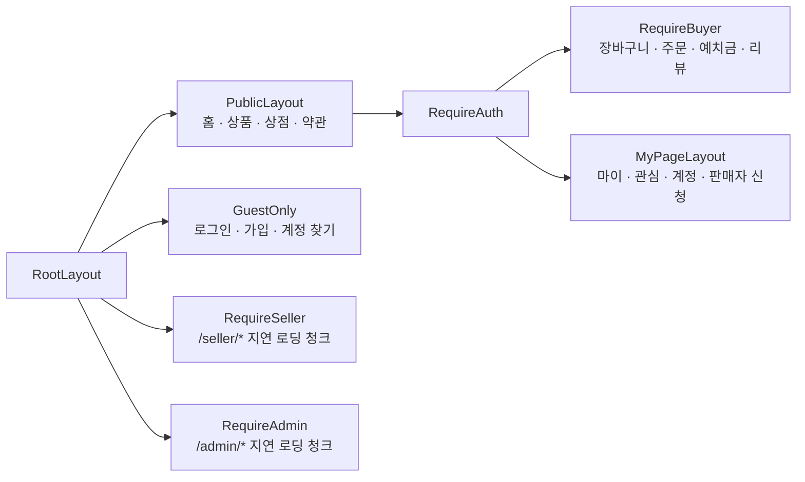
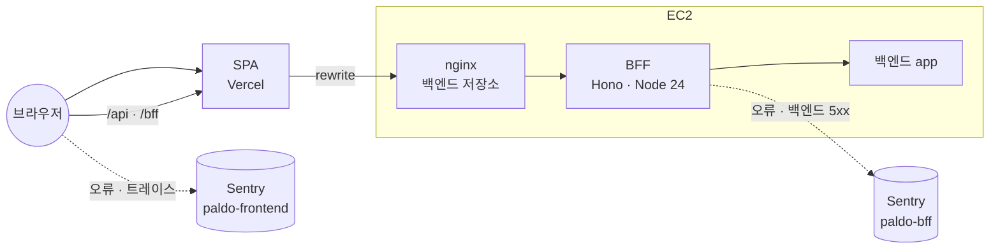

<div align="center">


# 팔도곳간 Frontend

**소규모 농가가 농산물을 직접 판매하는 직거래 마켓의 웹 프론트엔드**

구매자 서비스(`/`), 판매자 센터(`/seller/*`), 운영 콘솔(`/admin/*`)을 한 앱에서 라우트로 나눕니다.<br>
모든 API 요청은 같은 저장소의 BFF(Hono)를 거쳐 백엔드에 닿습니다.

[](https://github.com/prgrms-be-adv-devcourse/beadv8_1_200OK_FE/actions/workflows/bff-image.yml)      

[서비스 바로가기](https://paldo-gotgan-fe.vercel.app) · [빠른 시작](#-빠른-시작) · [아키텍처](#-아키텍처) · [우리가 푼 문제](#-우리가-푼-문제) · [백엔드 저장소](https://github.com/prgrms-be-adv-devcourse/beadv8_1_200OK_BE)

</div>

## 📚 목차

- [주요 기능](#-주요-기능)
- [아키텍처](#-아키텍처)
- [기술 스택](#-기술-스택)
- [빠른 시작](#-빠른-시작)
- [디렉터리 구조와 의존 방향](#-디렉터리-구조와-의존-방향)
- [우리가 푼 문제](#-우리가-푼-문제)
- [협업 방식](#-협업-방식)
- [CI/CD와 배포](#-cicd와-배포)
- [알고 있는 한계](#-알고-있는-한계)
- [문서](#-문서)

## ✨ 주요 기능

백엔드 API에 연결된 화면만 적었습니다. 아직 API가 없는 곳은 [알고 있는 한계](#-알고-있는-한계)에 있습니다.

| 구매자 | 판매자 센터 | 운영 콘솔 | 공통 |
|---|---|---|---|
| 회원 가입 · 로그인, 내 정보 수정, 비밀번호 변경 | 입점 신청과 신청 현황 확인 | 판매자 입점 심사(승인 · 반려) | 토큰 만료 시 자동 재발급(동시 요청도 재발급 1번) |
| 상품 검색(검색어 · 카테고리 · 지역 · 정렬)과 오타 제안 | 상품 등록 · 수정, 판매 상태 · 노출 변경, 삭제 | 정산 조회 · 실행, 수동 조정 | 사진 · 영상 업로드(올리는 중에는 제출을 막음) |
| 상품 상세, 리뷰와 리뷰 키워드, 판매자 상점 보기 | 출고 목록과 송장 등록 | 정산이 막힌 주문 확인 · 해결, 해결 기록 | 판매자 · 관리자 화면은 따로 지연 로딩 |
| 관심 상품(찜) 등록 · 해제와 목록 | 배송지 변경 요청 승인 · 거절 | 정산 입금 대사 확인 | 오류는 해요체 안내로, 422는 입력 칸에 표시 |
| 장바구니(수량 · 선택 · 삭제) | 취소 요청 처리 | 멈춘 충전 건 처리(완료 · 실패 · 결제 취소) | API가 없는 곳은 '연결 전'으로 표시 |
| 주문서(기본 배송지, 배송비 견적, 중복 주문 방지 키) | 정산 내역 · 상세, 판매자 잔액 | 검색 점검(0건 검색어 · 태그 없는 상품) | 오류 · 트레이스를 Sentry로 수집 |
| 예치금 약관 동의 · 충전(토스페이먼츠) · 이용 내역 | 상품별 리뷰 감성 · 키워드 분석 | 리뷰 분석 테스트 | 화면 상태 갤러리 `/__design`(개발 서버 전용) |
| 주문 목록 · 상세, 배송 조회, 구매확정 | 상점 프로필(출고지 우편번호 포함) | | |
| 출고 전 취소 요청 · 철회, 취소 요청 내역 | | | |
| 리뷰 작성 · 수정 · 삭제(사진 · 영상 첨부) | | | |

### 화면 묶음과 가드



- 라우트 표는 [`src/app/routes.tsx`](src/app/routes.tsx) 한 파일입니다.
- 가드는 화면 표시만 막습니다. 권한은 서버가 확인합니다(SELLER · ADMIN API는 권한이 없으면 403).

## 🧱 아키텍처



- SPA는 Vercel에 정적 파일로 올립니다. `/api/*`와 `/bff/*`는 Vercel rewrite로 EC2에 보냅니다([`vercel.json`](vercel.json)).
- nginx는 `/api/v1/`과 `/bff/`를 모두 BFF로 보냅니다. BFF는 백엔드와 같은 EC2에서 별도 compose 프로젝트로 뜹니다([`deploy/`](deploy)).
- 프론트 코드는 BFF를 몰라도 됩니다. 경로는 `/api/v1/...` 그대로 쓰고, 백엔드 주소는 env로만 정합니다.
- 트레이스 헤더(`sentry-trace` · `baggage`)는 같은 오리진에만 붙습니다. 그래서 브라우저 → BFF가 한 트레이스로 이어집니다.

### BFF가 하는 일

BFF는 토큰을 브라우저에서 걷어내고, 백엔드가 서비스로 나뉘었을 때 화면용 응답을 합치려고 둡니다. 지금은 1단계입니다.

| 단계 | 내용 | 상태 |
|---|---|---|
| 1단계 | `/api/v1/*`을 경로 그대로 넘기고, 브라우저가 보낸 `Authorization`도 그대로 넘깁니다 | 운영 중 |
| 1.5단계 | 1단계 BFF를 운영 EC2에 올립니다. 화면은 바뀌지 않습니다 | 완료 |
| 2단계 | 프론트를 HttpOnly 토큰 쿠키로 바꾸고 `authToken.ts`의 토큰 보관을 걷어냅니다 | BFF 쪽만 구현 · 테스트 완료 |

1단계에서도 BFF가 맡는 일이 있습니다.

| 기능 | 내용 | 코드 |
|---|---|---|
| 상품 상세 캐시 | `GET /api/v1/products/{id}`를 5초 메모리에 두고, 같은 상품 동시 요청은 백엔드에 1번만 보냅니다 | [`productCache.ts`](bff/src/productCache.ts) |
| 응답 압축 | 1KB 이상 응답을 gzip으로 보냅니다. 토큰이 담긴 인증 응답은 압축하지 않습니다(BREACH) | [`compression.ts`](bff/src/compression.ts) |
| 본문 상한 | multipart가 아닌 본문은 2MB를 넘으면 백엔드를 부르지 않고 413을 줍니다 | [`bodyLimit.ts`](bff/src/bodyLimit.ts) |
| 백엔드 5xx 보고 | 백엔드에는 Sentry가 없어서 BFF가 5xx를 모듈 · 경로 · 상태별 이슈로 올립니다 | [`backendReport.ts`](bff/src/backendReport.ts) |
| CSRF 검사 | 상태를 바꾸는 요청의 `Origin`을 확인합니다. 세션 쿠키 없는 `/api/*`는 보지 않습니다 | [`originGuard.ts`](bff/src/originGuard.ts) |
| 오류 형식 | BFF가 내는 오류도 `application/problem+json`이고 `detail`은 해요체입니다 | [`problem.ts`](bff/src/problem.ts) |

<details>
<summary>2단계 준비물: 토큰 쿠키 세션과 화면 조합 API</summary>

- 세션 저장소는 없습니다. 백엔드 토큰을 HttpOnly 쿠키 두 개에 담습니다([`session/cookie.ts`](bff/src/session/cookie.ts)).
  - access: `__Host-paldo_at`(`Path=/`)
  - refresh: `__Secure-paldo_rt`(`Path=/bff/session`, 재발급 요청에만 실림)
  - 개발(http)에서는 접두어 없이 `paldo_at` · `paldo_rt`입니다.
- 같은 refresh로 온 재발급은 한 번만 하고 결과를 10초 기억합니다(여러 탭 대비, [`session/refresher.ts`](bff/src/session/refresher.ts)).
- 로그아웃은 백엔드 `POST /api/v1/auth/logout`으로 그 기기의 refresh 세션을 끊고 쿠키를 지웁니다.
- 화면 조합 API `GET /bff/products/:id/detail`은 상품 · 리뷰 · 내 리뷰를 동시에 부릅니다. 리뷰가 실패해도 화면은 그립니다([`screens/productDetail.ts`](bff/src/screens/productDetail.ts)).
- Redis 세션 저장소는 만들어 두고 쓰지 않습니다. BFF가 여러 대가 되거나 서버에서 세션을 끊어야 할 때 되살립니다([`session/redis.ts`](bff/src/session/redis.ts) 맨 위 설명).
- 프론트는 아직 `/bff/session/*`과 `/bff/products/:id/detail`을 부르지 않습니다. 2단계 작업은 코드의 `TODO(bff-2단계)` 주석을 따라갑니다.

</details>

### 프론트 인증

- accessToken(30분) · refreshToken은 메모리 + sessionStorage에 둡니다([`authToken.ts`](src/shared/api/authToken.ts)). 새로고침해도 유지되고, 탭을 닫으면 다시 로그인합니다.
- 역할과 회원 번호는 토큰 payload(`sub` · `roles[]`)에서 읽습니다. 표시용이고, 검증은 백엔드가 합니다.
- 401이 오면 한 번 재발급하고 같은 요청을 다시 보냅니다. 동시에 여러 요청이 만료를 만나도 재발급은 한 번입니다([`reissue.ts`](src/shared/api/reissue.ts)).

## 🧰 기술 스택

| 분류 | 기술 |
|---|---|
| **UI** |      |
| **라우팅 · 상태** |    |
| **폼 · 검증 · HTTP** |    |
| **BFF** |    |
| **외부 연동** |   |
| **테스트 · 품질** |     -2EAD33?logo=playwright&logoColor=white) |
| **배포** |     |
| **협업** |   |

| 영역 | 선택 |
| --- | --- |
| UI | React 19, TypeScript 6, Vite 8 |
| 라우팅 | React Router 8 (data mode, `react-router` + `react-router/dom`) |
| 서버 상태 | TanStack Query 5 |
| 클라이언트 상태 | Zustand 5 (체크아웃 배송지 초안 하나만. 로그인 상태는 토큰에서 읽음) |
| HTTP | Axios |
| 폼·검증 | React Hook Form + Zod 4 (`@hookform/resolvers`) |
| UI 컴포넌트 | Mantine 9 + CSS Modules (postcss-preset-mantine) |
| 품질 | Biome 2 (lint + format), Vitest 5 + Testing Library, MSW 3 (테스트 전용) |
| BFF | Hono + `@hono/node-server`, Zod로 env 검증, Node 24가 `.ts`를 그대로 실행(빌드 단계 없음) |
| 관측 | Sentry (`@sentry/react` · `@sentry/hono`) |

## 🚀 빠른 시작

명령은 모두 저장소 루트에서 실행합니다.

### 사전 준비

- Node 24 LTS(`.nvmrc`). Node 23 · 24.15 미만은 jsdom · react-router가 지원하지 않습니다.
- pnpm은 corepack으로 켭니다. `package.json`의 `packageManager`(pnpm 12) 버전을 그대로 씁니다.
- 로컬 백엔드: [백엔드 저장소](https://github.com/prgrms-be-adv-devcourse/beadv8_1_200OK_BE)의 빠른 시작대로 `http://localhost:8080`에 띄웁니다.

### 실행

```bash
nvm use                  # .nvmrc의 Node 24 LTS. Node 23·24.15 미만은 jsdom·react-router가 지원하지 않음
corepack enable pnpm     # 처음 한 번. package.json의 packageManager(pnpm 12) 버전을 그대로 씀
cp .env.example .env     # 환경변수
cp bff/.env.example bff/.env   # BFF 환경변수. BACKEND_URL 기본값은 http://localhost:8080
pnpm install
pnpm dev                 # vite(5173) + BFF(8787)를 같이 띄움
```

- `pnpm dev`는 Vite 개발 서버와 BFF를 같이 띄웁니다. 개발 서버는 `/api` · `/bff`를 BFF(`VITE_BFF_PROXY_TARGET`, 기본 `http://localhost:8787`)로 보냅니다.
- 화면 상태 갤러리는 `http://localhost:5173/__design`입니다. 개발 서버에서만 열립니다.
- 예치금 충전 결제창을 쓰려면 `.env`의 `VITE_PG_CLIENT_KEY`에 토스페이먼츠 클라이언트 키를 넣습니다.

> [!IMPORTANT]
> `.env`, `bff/.env`, 토스 · Sentry 키는 커밋하지 않습니다.

패키지 매니저는 **pnpm**이에요(`pnpm-lock.yaml`). 패키지 추가는 `pnpm add <패키지>`(개발용 `-D`), 일회성 실행은 `pnpm dlx`.
pnpm은 나온 지 24시간이 안 된 버전을 바로 설치하지 않아요(공급망 보호). 꼭 필요하면 `pnpm-workspace.yaml`의 `minimumReleaseAgeExclude`에 그 버전을 적어요(lock을 새로 만들 때 pnpm이 자동으로 넣기도 해요).
설치 스크립트 실행 여부를 정하지 않은 의존성이 있으면 pnpm 12가 설치를 멈춥니다. 그래서 `pnpm-workspace.yaml`의 `allowBuilds`에 적어 둡니다.

### 스크립트

| 스크립트 | 설명 |
| --- | --- |
| `pnpm dev` | Vite 개발 서버(5173) + BFF(8787) |
| `pnpm dev:web` / `dev:bff` | 둘 중 하나만 실행 |
| `pnpm build` / `preview` | 프로덕션 빌드(`tsc -b` 포함) / 빌드 미리보기 |
| `pnpm check` / `check:fix` | Biome lint + format 검사 / 자동 수정 (`bff/` 포함) |
| `pnpm lint` / `format` | Biome lint만 / format만 |
| `pnpm typecheck` | TypeScript 프로젝트 참조 빌드 + BFF 타입 검사 |
| `pnpm test` / `test:watch` | Vitest 프론트 + BFF / 프론트 watch |
| `pnpm --filter @paldo/bff test:redis` | 쓰지 않는 Redis 세션 저장소 테스트(Testcontainers, Docker 필요) |

> [!NOTE]
> 작업을 마치기 전에 `pnpm typecheck` · `pnpm check` · `pnpm test`가 모두 통과해야 합니다.

### BFF 이미지

```bash
docker build -f bff/Dockerfile .   # 컨텍스트는 저장소 루트
```

운영 배치와 롤백은 [`deploy/README.md`](deploy/README.md)를 봅니다.

## 📁 디렉터리 구조와 의존 방향

```
src/
  app/        진입·providers·router·layouts·guards·chunks     (features, shared import 가능)
  features/   auth products farms cart checkout orders reviews wallet me sellerApply seller admin
              (공개한 index.ts만 import. sellerApply는 구매자 쪽 신청 화면, seller는 판매자 센터 청크)
  shared/     api ui lib styles                               (features·app import 금지)
  mocks/      MSW 핸들러 (Vitest 테스트 전용)
  test/       Vitest setup·유틸
bff/          Hono BFF (pnpm workspace 패키지 @paldo/bff)
deploy/       BFF 운영 compose·배포 스크립트
demo/         운영 시연 실행기 (Playwright)
docs/         시안과 다르게 만든 곳
```

- 의존 방향은 `app → features → shared` 단방향이며 Biome `noRestrictedImports`로 검사한다.
- 각 feature는 `index.ts`로 공개한 것(pages · hooks 등)만 밖에서 쓴다. `api.ts`·`queries.ts`·`schemas.ts`·`store.ts`·`components/`는 외부 import 금지.
- 예외: `products → cart` (상품 상세의 담기), `me → sellerApply` (마이페이지의 판매자 메뉴 상태). 그 외 공유가 필요하면 `shared`로 승격.
- 앱 코드는 `src/mocks`를 import하지 않는다. 화면(pages · views · components · layouts)은 fixtures를 import하지 않는다.
- feature 안 파일 역할:

| 파일 | 역할 |
|---|---|
| `api.ts` / `queries.ts` | 요청 함수 / 쿼리 키와 훅 |
| `pages/` | 라우트 컴포넌트. 쿼리 · mutation · 라우터를 연결해 View에 props로 넘김 |
| `views/` | 표시 전용. props만 받고 API · 쿼리 · 스토어를 import하지 않음 |
| `fixtures.ts` / `previews.tsx` | 샘플 데이터 / `/__design` 화면 상태 갤러리. 테스트 · previews 전용 |

- 폴더별 책임과 작업 규칙은 [`CLAUDE.md`](CLAUDE.md), [`src/app/README.md`](src/app/README.md), [`src/shared/CLAUDE.md`](src/shared/CLAUDE.md)에 적혀 있다.

## 🧩 우리가 푼 문제

> 수치는 PR 본문과 로컬 측정 값입니다. 운영 환경에서 다시 잰 값은 없습니다.

<details>
<summary><strong>1. 1회용 refresh를 여러 요청이 동시에 쓰면 로그아웃됨</strong></summary>

**문제**

- 화면은 요청을 여러 개 동시에 보냅니다. access가 만료되면 요청마다 같은 refresh로 재발급을 시도합니다.
- 백엔드 refresh는 1회용입니다. 둘째 재발급부터 401이 되어 사용자가 로그아웃됩니다.

**해결**

- 프론트: 진행 중인 재발급 Promise를 공유합니다. 동시 요청이 몇 개든 재발급은 한 번입니다([`reissue.ts`](src/shared/api/reissue.ts)).
- BFF(2단계용): refresh별로 진행 중인 재발급을 합치고, 끝난 결과를 10초 기억합니다. 쿠키가 바뀌기 전에 다른 탭이 보낸 요청도 같은 새 토큰을 받습니다([`refresher.ts`](bff/src/session/refresher.ts)).

**결과**

- 테스트로 확인합니다. "동시에 여러 요청이 만료를 만나도 재발급은 한 번만 한다"([`client.test.ts`](src/shared/api/client.test.ts)), "여러 탭이 같은 refresh로 동시에 재발급해도 백엔드 재발급은 한 번"([`session.test.ts`](bff/src/session/session.test.ts)).
- 한계: BFF가 여러 대가 되면 메모리 합치기로는 막지 못합니다. 그때는 만들어 둔 Redis 저장소를 되살립니다.

</details>

<details>
<summary><strong>2. 한 상품에 요청이 몰리면 백엔드 DB 커넥션을 같이 씀</strong></summary>

**문제**

- 상품 상세는 비회원도 보는 공개 조회입니다. 한 상품에 요청이 몰리면 백엔드 DB 커넥션 풀을 같이 씁니다.
- 운영에서 측정된 문제는 아닙니다. 예방 목적입니다.

**해결**

- 모든 `/api/v1` 요청이 BFF를 지나므로, BFF가 상세 응답 전체를 5초 메모리에 둡니다.
- 같은 상품 동시 요청은 백엔드에 한 번만 보냅니다(single-flight). 200만 담고, 판매자가 수정 · 상태 변경 · 삭제에 성공하면 그 상품을 바로 지웁니다.
- 개수 500개와 본문 합계 16MB를 넘으면 오래된 것부터 버립니다. 운영 컨테이너 메모리 상한(256MB) 때문에 바이트 상한을 더했습니다.
- 버린 대안: nginx 프록시 캐시(즉시 지우기가 어렵고 백엔드 저장소 소관), Redis 캐시(BFF는 한 대).
- 감수한 것: 구매자는 최대 5초 늦은 품절 · 가격을 볼 수 있습니다. 주문할 때 백엔드가 가격 · 재고를 다시 확인합니다.

**결과** (로컬 측정, 노트북 한 대, k6 초당 800건 × 60초, 80%는 인기 상품 3개)

| 구성 | p95 | 백엔드 요청 | DB 커넥션 획득 |
|---|---|---|---|
| 백엔드 직접 | 1.11ms | 48,000 | 48,016 |
| BFF, 합치기만(TTL 0) | 2.54ms | 42,898 (−10.6%) | 42,921 |
| BFF, 5초 캐시 | 0.68ms | 593 (−98.8%) | 613 |

- 목적(커넥션 사용 줄이기)은 확인했습니다. 로컬 백엔드가 이미 1ms 안이라 응답 시간 이득은 작습니다.

자세히: [PR 54](https://github.com/prgrms-be-adv-devcourse/beadv8_1_200OK_FE/pull/54)

</details>

<details>
<summary><strong>3. 응답은 압축 없이, 요청 본문은 상한 없이 오감</strong></summary>

**문제**

- nginx에 gzip 설정이 없었습니다. 상품 목록 · 상세 JSON이 압축 없이 모바일로 갔습니다.
- BFF는 multipart가 아닌 본문을 메모리에 통째로 담는데 상한이 없었습니다. nginx 상한(32MB)까지 JSON 하나가 메모리를 차지할 수 있었습니다.

**해결**

- 1KB 이상 응답을 `Accept-Encoding`에 따라 gzip으로 압축합니다. 백엔드가 작은 응답도 chunked로 보내 크기를 모르므로, 처음 1KB를 읽어 보고 정합니다.
- `/api/v1/auth/*` · `/bff/session/*`는 토큰이 담긴 응답이라 압축하지 않습니다(BREACH 대비).
- multipart가 아닌 본문은 2MB를 넘으면 백엔드를 부르지 않고 413을 줍니다. 근거는 상품 상세설명 최대 20만 자(한글 약 600KB)입니다.

**결과**

- 상품 목록(20개) 응답: 7,824B → 989B
- 상세(668B)는 1KB 미만이라 압축하지 않습니다.

자세히: [PR 53](https://github.com/prgrms-be-adv-devcourse/beadv8_1_200OK_FE/pull/53)

</details>

<details>
<summary><strong>4. BFF를 거친 응답을 브라우저가 읽지 못함</strong></summary>

**문제**

- BFF를 거친 응답 본문을 브라우저가 해석하지 못했습니다.

**원인**

- Node `fetch`는 gzip 응답을 풀어서 줍니다. 그런데 `content-encoding` · `content-length` 헤더는 원래 값 그대로 남습니다.
- 브라우저는 이미 풀린 본문을 다시 풀려고 했습니다.

**해결**

- 백엔드 응답을 넘길 때 두 헤더를 지웁니다([`upstream.ts`](bff/src/upstream.ts)의 `relay()`).
- 프록시를 직접 만들 때만 만나는 함정이라 BFF 첫 커밋(`940a6ba`)에서 바로잡았습니다.

</details>

<details>
<summary><strong>5. 30MB 업로드를 흘려보내면 401일 때 다시 보낼 수 없음</strong></summary>

**문제**

- 리뷰 영상은 최대 30MB입니다. multipart를 메모리에 담으면 BFF 메모리(256MB 상한)를 압박합니다.
- 흘려보내면(스트리밍) 본문을 한 번만 읽을 수 있어서, 토큰 만료 401이 와도 같은 요청을 다시 보낼 수 없습니다.

**해결**

- multipart만 스트리밍하고 재시도하지 않습니다(Node `fetch`의 `duplex: 'half'`). 그 밖 본문은 메모리에 담아 재시도합니다([`proxy.ts`](bff/src/proxy.ts)).
- 업로드 timeout은 BFF 120초, nginx 130초로 맞췄습니다.
- 2단계 쿠키는 access 만료 30초 전에 사라지게 해서, 업로드 도중 만료 401 자체를 피합니다([`cookie.ts`](bff/src/session/cookie.ts)).
- 업로드 중 BFF 메모리 사용량은 아직 재지 않았습니다.

</details>

<details>
<summary><strong>6. 백엔드 배포가 BFF 이미지에 묶임</strong></summary>

**문제**

- 처음에는 백엔드 운영 compose에 BFF를 넣으려 했습니다([백엔드 PR 345](https://github.com/prgrms-be-adv-devcourse/beadv8_1_200OK_BE/pull/345)).
- 리뷰에서 지적이 나왔습니다. 배포 스크립트 하나가 app과 BFF 이미지를 함께 받아서, BFF 이미지가 없거나 권한이 없으면 백엔드 배포까지 멈춥니다.

**해결**

- BFF는 같은 EC2에서 프론트 저장소의 별도 compose 프로젝트로 띄웁니다([`deploy/`](deploy)).
- 백엔드 compose는 `paldo-edge` 네트워크와 nginx만 맡습니다([백엔드 PR 434](https://github.com/prgrms-be-adv-devcourse/beadv8_1_200OK_BE/pull/434)). BFF는 그 네트워크에 붙고, 호스트 포트는 열지 않습니다.
- 저장소마다 자기 서비스만 배포 · 롤백합니다. 대신 `paldo-edge`라는 이름이 두 저장소의 계약이 됐습니다.

자세히: [PR 9](https://github.com/prgrms-be-adv-devcourse/beadv8_1_200OK_FE/pull/9)

</details>

<details>
<summary><strong>7. Vercel 미리보기 배포에서 POST가 전부 403</strong></summary>

**문제**

- BFF는 CSRF를 막으려고 허용 목록 밖 `Origin`의 POST를 거절합니다.
- Vercel 미리보기 배포는 배포마다 주소가 바뀝니다. 그래서 미리보기에서 보낸 POST가 모두 403이었습니다.

**원인**

- CSRF는 브라우저가 인증 정보(쿠키)를 자동으로 실을 때만 생깁니다.
- 1단계의 `Authorization: Bearer`는 프론트 코드가 직접 붙입니다. 다른 사이트가 대신 보낼 수 없습니다.

**해결**

- 세션 쿠키 없는 `/api/*`는 `Origin`을 보지 않습니다. 쿠키를 실은 요청과 `/bff/*`는 계속 검사합니다(로그인 CSRF 대비).
- 미리보기 주소 패턴을 허용 목록에 넣는 대안은 버렸습니다.
- 규칙마다 테스트가 있습니다([`session.test.ts`](bff/src/session/session.test.ts)의 Origin 테스트).

</details>

## 🤝 협업 방식

- **브랜치:** `dev`에서 `feature/#이슈번호` 브랜치를 만들고 PR로 `dev`에 합칩니다. `main`은 배포하는 코드입니다.
- **PR:** 개요 · 작업 내용 · 참고 사항 · 관련 이슈 · 완료 조건을 적습니다. 완료 조건에는 `typecheck` · `check` · `test` 통과를 넣습니다.
- **구조 규칙 강제:** 의존 방향과 fixtures 금지를 Biome `noRestrictedImports`로 막습니다. 사람이 쓰든 AI가 쓰든 규칙을 어기면 `pnpm check`가 실패합니다.
- **'연결 전'을 숨기지 않기:** 실제 화면은 fixtures를 그리지 않습니다. API가 없는 곳은 `NotConnected`, 모르는 숫자는 `–`, 부르지 못하는 버튼은 막고 이유를 보여 줍니다. 비어 보이는 이유가 '데이터 없음'인지 '연결 전'인지 구분하려는 규칙입니다.
- **테스트:** API가 엮인 동작은 MSW로 테스트합니다. 핸들러가 없는 요청은 테스트를 실패시킵니다. 버그를 고치면 재현 테스트를 같이 더합니다.
- **AI 협업:** 팀 규칙을 [`CLAUDE.md`](CLAUDE.md)에 두어 Claude Code도 같은 규칙으로 작업합니다. PR마다 Claude 리뷰 봇이 먼저 보고, PR · 이슈 댓글에서 `@claude`로 부를 수 있습니다.

| 숫자로 보기 | |
|---|---|
| feature 폴더 | 12개 |
| 테스트 파일 | 프론트 86개 · BFF 14개 |
| 머지된 PR | 48개 |

## 🔄 CI/CD와 배포

| 워크플로 | 하는 일 |
|---|---|
| `bff-image` | `main`에 `bff/`나 의존성 파일이 바뀌어 push되면 BFF 이미지를 GHCR `paldo-gotgan-bff`(`latest` · SHA 7자리)에 올립니다 |
| `deploy` | 수동 실행으로 SPA를 Vercel에 배포합니다(preview · production 선택) |
| `claude-code-review` | PR이 열리거나 바뀔 때 Claude가 코드를 리뷰합니다 |
| `claude` | PR · 이슈 댓글에서 `@claude`를 부르면 응답합니다 |

- BFF 배포는 서버에서 `./deploy.sh`로 합니다. 롤백은 `.env`의 `BFF_IMAGE_TAG`를 SHA 태그로 바꾼 뒤 다시 `./deploy.sh`입니다([`deploy/README.md`](deploy/README.md)).
- BFF 이미지에는 `org.opencontainers.image.revision` 라벨이 붙고, BFF의 Sentry release도 같은 커밋 SHA입니다.
- nginx와 `paldo-edge` 네트워크는 [백엔드 저장소](https://github.com/prgrms-be-adv-devcourse/beadv8_1_200OK_BE)에 있습니다.

## 🔭 알고 있는 한계

<details>
<summary>지금 알고 있는 한계</summary>

| 한계 | 지금 상태 |
|---|---|
| 토큰이 아직 브라우저 JS에 있음 | BFF 2단계(토큰 쿠키)는 BFF 쪽만 구현했고, 프론트는 sessionStorage 토큰을 씁니다 |
| BFF가 한 대라는 가정 | 재발급 합치기와 상품 캐시가 프로세스 메모리에 있습니다. 여러 대가 되면 다시 봐야 합니다 |
| BFF가 죽으면 API 전체가 502 | 서비스 운영 전이라 nginx에 앱 직결 스위치를 두지 않았습니다. 이미지 태그 롤백으로 되돌립니다 |
| 화면 조합 효과가 작음 | 백엔드에 모듈을 넘는 공개 조회 API가 없어, 지금 있는 조합은 같은 모듈 호출뿐입니다 |
| CI에서 테스트를 돌리지 않음 | 워크플로는 이미지 빌드 · 배포 · 리뷰 봇입니다. 테스트와 Biome은 각자 로컬에서 돌립니다 |
| 측정은 모두 로컬 | 운영 환경에서 다시 잰 값은 없습니다 |
| 아직 API가 없는 화면 | 팔로우 · 회원 탈퇴 · 배송지 삭제, 아이디 · 비밀번호 찾기, 배송지 변경 요청 · 문의, 판매자 출고 지연 · 판매자 취소 · 출금 · 홈 주문 집계, 관리자 1건 정산 등은 '연결 전'으로 보입니다. 전체 목록은 [`CLAUDE.md`](CLAUDE.md)의 'API가 없는 곳'에 있습니다 |

</details>

## 📄 문서

| 문서 | 내용 |
|---|---|
| [`CLAUDE.md`](CLAUDE.md) | 명령어, 구조, 서버 연결, Sentry, BFF, API가 없는 곳, 테스트, 화면 작업, 문구 규칙 |
| [`src/app/README.md`](src/app/README.md) | 진입 · 라우트 · 레이아웃 · 가드 · 청크 · 개발용 갤러리 |
| [`src/shared/CLAUDE.md`](src/shared/CLAUDE.md) | 공통 api · ui · lib · styles 규칙 |
| [`deploy/README.md`](deploy/README.md) | BFF 운영 배포와 롤백 |
| [`demo/README.md`](demo/README.md) | 운영 사이트에서 가입부터 정산까지 도는 Playwright 시연 실행기 |
| [`docs/design-deviations.md`](docs/design-deviations.md) | 시안과 다르게 만든 곳 |
| [`.env.example`](.env.example) · [`bff/.env.example`](bff/.env.example) | 프론트 · BFF 환경변수 |
| [백엔드 README](https://github.com/prgrms-be-adv-devcourse/beadv8_1_200OK_BE) | 백엔드 모듈 구조, 돈이 도는 흐름, 로컬 실행 |

<p align="center"><sub>팔도곳간 · 팀 200Ok</sub></p>
